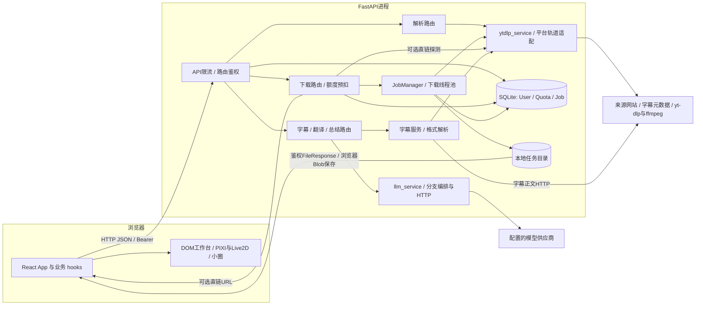
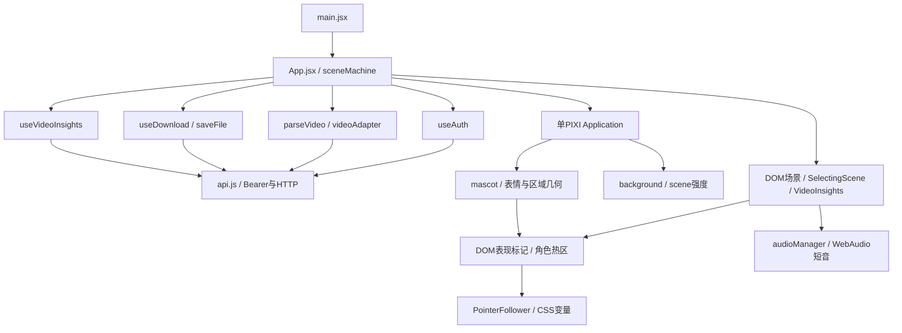

# 方案设计文档 · 万能视频下载网站

> **F-003最终范围（2026-10-17，用户已查验）：** data-ui-follow仅控制标题倾斜，不再是小圈显示前提；小圈可在内容列两侧显示。避让只含.site-header、显式parse表单和model alpha轮廓，普通button/link/dialog不再统一排除；模型与拖动边界未改。见[本轮交验](implementation-reports/2026-10-17-f003-circle-scope.md)，下方宽泛控件避让描述按之前阶段阅读。

> **F-003待机行为（2026-10-17，用户已查验）：** 自动漫游及新增的位置/暂停菜单已撤销。角色保持当前位置，拖动后停在新位置，原呼吸、摆头、换装、表情与道具待机继续；焦点、系统减少动态和后台状态不触发应用主动暂停。手机门控和小圈联动保留。F-006实现与验证完成、等待用户查验，见[实施报告](implementation-reports/2026-10-17-f006.md)；本轮见[待机交验](implementation-reports/2026-10-17-f003-original-behavior.md)。

> **F-003续调历史记录：** 页面角色菜单/暂停活动额外按钮已取消；鼠标悬停不再暂停模型。该阶段曾保留模型内部控制菜单。F-006此前仅作后续登记的状态已被用户后续指示更新，当前进度见[总表](follow-up-plan.md)。

> **架构审视状态（2026-10-16）：已完成。** 已按当前源码和锁文件更新运行拓扑、职责、数据流、配置组合及前端实际模块，完成独立复核和静态检查。完成依据见[总表F-005](follow-up-plan.md#9-f-005技术架构审视2026-10-16)；审视发现的结构整改项单独跟踪。

> 版本：v3（2026-10-16 按当前源码审视架构；保留对应历史证据）
> 对应需求见[requirements.md](requirements.md)。phase15的[报告](acceptance-reports/2026-10-16-deepseek-source-screen/report.md)和[内容审阅](acceptance-reports/2026-10-16-deepseek-source-screen/content-review.md)已封账，质量缺陷保留。后续F-001已实现长文产品入口：公开默认60000字符、超过20000走独立完整字幕Pro/text/high路径；短中仍legacy/adaptive/single、fidelity=off。技术验证完成、待用户查验，未部署/真实模型复验，见[交验记录](implementation-reports/2026-10-16-f001.md)。
> 本文档是**当前实现的架构基准**。运行/依赖/数据流见§1–11，LLM边界与组合见§12.6–12.7，前端真实模块见§13；§12早期阶段及§14保留历史，§15–16说明当前UI的演进与实现。源码发现的风险不是已完成整改，后续执行统一见总表。

---

## 0. 工程约定（每次遵守）

> 遵循当前 `AGENTS.md`、有效用户指令及上级指令。`CLAUDE.md` 是项目补充说明，不具有最高优先级；历史计划不能覆盖后续用户要求。

1. **UI 必须用 skill**：配色/字体/动效/无障碍/组件先调用 `ui-ux-pro-max` + `design-system`。
2. **skill 优先于计划**：冲突时以 skill 为准（如「每屏最多动 1–2 个关键元素」> 常驻动画清单）。
3. **不写死、保留扩展**：颜色/字体/时长走 `:root` token；新增能力数据驱动、可配置，避免大规模重构。
4. **解耦**：核心模块对外只暴露窄接口（后端 `ytdlp_service.py` 唯一接触 yt-dlp；前端视觉层只读 `scene`、不改下载状态、不 import 下载核心）；层与模块通过稳定接口通信，扩展不触碰既有核心。
5. **成熟方案优先，避免重复造轮子**：设计前复用已确认资料、调研成熟库/框架/官方方案，适用时优先集成；自研聚焦业务差异与适配。选型记录来源、版本、兼容性、维护/许可证/资源成本及不适用的具体原因。执行 [AGENTS.md §10](../AGENTS.md)，既有自研实现不构成跳过成熟方案评估的理由。

---

## 1. 架构总览

当前是**React单页前端 + FastAPI模块化单体后端**。后端分为认证/额度、解析/下载、字幕/翻译/总结三条业务链；只有服务端下载交给专用进程内线程池。LLM总结仍是同步HTTP请求链中的工作。SQLite存储用户、额度和Job，不保存可恢复的执行队列；独立验收runner与Ragas不在产品请求链上。



图中节点是现有模块职责，不表示独立服务或容器。ffmpeg由yt-dlp后处理调用，当前没有常驻媒体服务、消息代理、LLM任务服务或Ragas生产门禁。

### 1.1 相对早期设计的变化

| 早期说明或需要澄清的边界 | 当前实际架构 |
| --- | --- |
| v1只画React→FastAPI→yt-dlp | 已增加JWT/额度、本人Job隔离、字幕平台适配、翻译和多种总结分支，以及独立评测工具 |
| yt-dlp、线程池、SQLite画在同层 | yt-dlp是适配边界；JobManager拥有下载执行池；SQLModel负责持久化。解析/直链探测/字幕/LLM不受下载池并发上限控制 |
| 单一场景驱动全部界面 | 下载业务由sceneMachine保存，认证及视频内容各有独立hook状态；App负责组合，DOM与PIXI通过句柄/几何桥接 |
| 电影感fx目录及章节台词组件 | 当前入口是实际场景组件、VideoInsights、PointerFollower及PIXI模块；旧计划中的多数组件未实现，见§13 |
| 独立全文Pro实验可视作默认总结能力 | phase13–15在验收目录直接HTTP调用；公开API仍走summarize_text并返回结构化字段，二者未完成产品接入 |
| 原图未表达业务持久化和执行恢复、单进程和多进程的区别 | 当前执行队列、限流与下载上限均属进程；没有重启恢复或跨worker统一调度 |

### 1.2 审视依据

本章基于2026-10-16当前工作区源码（含未提交改动）与仓库锁文件的静态检查，未导入运行产品、读取部署env或重跑模型/测试。关键入口是[main.py](../backend/app/main.py)、[App.jsx](../frontend/src/App.jsx)、[下载路由](../backend/app/routes/download.py)、[共用字幕入口](../backend/app/routes/insight_common.py)、[总结路由](../backend/app/routes/summary.py)及[LLM服务](../backend/app/services/llm_service.py)。架构风险和后续处理只登记在[总表F-005](follow-up-plan.md#9-f-005技术架构审视2026-10-16)。

## 2. 技术选型

下表是仓库**锁定版本**，不代表当前运行进程已安装或加载的版本；本轮未安装、升级依赖。

| 层 | 当前依赖及锁定版本 | 实际职责 |
| --- | --- | --- |
| Python API | Python声明≥3.12；FastAPI0.142.2 / Starlette1.7.0 / Uvicorn0.54.0 | 同步业务路由、HTTP中间件；配置在模块导入时实例化 |
| 下载适配 | yt-dlp2026.8.19；外部ffmpeg | 唯一集成层ytdlp_service处理解析/轨道/直链/下载，ffmpeg用于需要的媒体合并 |
| 持久化 | SQLModel0.0.47 / SQLAlchemy2.0.54 / SQLite | User、每日Quota、Job；create_all不是版本化数据库迁移；引擎参数当前包含SQLite专用设置 |
| 认证 | PyJWT2.15.1 + Python标准库PBKDF2 | JWT HS256、密码哈希及用户查询；没有服务端refresh/logout/吊销接口 |
| HTTP与结构 | HTTPX0.28.1 / Pydantic2.13.5 | 字幕与模型HTTP、请求/响应及内部schema校验；结构校验不证明内容忠实 |
| 生产内候选编排 | langchain-core1.6.9 / LangSmith0.14.7 | 两种固定LCEL序列与关闭追踪；这些包已被生产模块顶层导入，即使候选默认关闭仍是启动依赖 |
| 前端 | React/ReactDOM18.3.1 / Vite8.3.0 | 单页App、内建hooks/reducer；没有外部路由或全局状态库 |
| 视觉与音频 | PIXI6.5.10 / pixi-live2d-display0.4.0 / CSS / WebAudio | 单PIXI舞台、Live2D、DOM小圈及短音；未接Three.js、Lottie或独立动画引擎 |
| 开发检查 | 根pytest；前端Vitest5.0.1 | 现有离线测试工具；本轮仅静态架构核对 |
| 独立评估环境 | Ragas0.4.3 / langchain-community0.3.31 | tools/semantic_eval有独立pyproject及uv.lock；其core1.6.10、LangSmith0.14.8、Pydantic2.14.1与生产锁不同，不混装或写成产品依赖 |

版本来源：[根声明](../pyproject.toml)、[根锁](../uv.lock)、[前端声明](../frontend/package.json)、[前端锁](../frontend/package-lock.json)、[评估声明](../tools/semantic_eval/pyproject.toml)及[评估锁](../tools/semantic_eval/uv.lock)。

## 3. 目录结构

以下为现有目录；同组文件仅作职责归类，不表示已拆成独立包或服务。

```text
install_video/
├── backend/app/
│   ├── main.py                    # 路由挂载、内存IP限流、导入时init_db
│   ├── config.py / db.py          # 环境配置、SQLite engine/Session/create_all
│   ├── models.py / schemas.py     # User/Quota/Job、公开请求响应
│   ├── routes/
│   │   ├── auth.py / parse.py / download.py
│   │   ├── insight_common.py      # 字幕/翻译/总结共用load_subtitle与错误映射
│   │   └── subtitle.py / summary.py
│   └── services/
│       ├── auth.py / quota.py / quota_policy.py
│       ├── jobs.py                # JobManager、下载池、成功产物懒清理
│       ├── ytdlp_service.py       # 唯一yt-dlp集成与B站播放校验适配
│       ├── subtitle_sources.py / bilibili_subtitle_source.py
│       ├── subtitle_service.py / network_retry.py
│       ├── llm_service.py         # 传输、输入/预算/提示、分支编排与调用
│       ├── summary_output.py / summary_json.py
│       ├── summary_pipeline.py / summary_review.py
│       └── summary_facts.py / summary_normalization.py /
│           summary_references.py / summary_quality.py /
│           summary_audit_contract.py / summary_retry.py
├── backend/scripts/install_ffmpeg.*
├── frontend/
│   ├── vite.config.js / package.json / package-lock.json
│   └── src/
│       ├── main.jsx / App.jsx / api.js
│       ├── hooks/                # useAuth / useDownload / useVideoInsights
│       ├── state/                # sceneMachine / downloadConfig / insightConfig
│       ├── lib/                  # videoAdapter / saveFile
│       ├── components/           # DOM场景；ui内VideoInsights/菜单/小圈等
│       ├── pixi/                 # stage / background / mascot / config / theme
│       ├── audio/audioManager.js # 组件调用的短音合成
│       ├── styles/               # tokens / global / reference
│       └── fx/constants.js       # 历史残留，当前无生产导入
├── docs/
│   ├── follow-up-plan.md / design.md / requirements.md
│   ├── superpowers/              # 历史设计/计划，冻结原件保留
│   └── acceptance-reports/
│       ├── 2026-10-13-long-summary-fidelity/scripts/
│       │                         # phase13–15等独立验收runner实际位置
│       └── 2026-10-16-deepseek-source-screen/
│                                 # phase15报告/来源/结果，不是runner根目录
├── tools/semantic_eval/          # 独立Ragas环境及runner，非产品路由
├── exports/                     # 已保存输出的原样导出
└── pyproject.toml / uv.lock
```

仓库根目录没有`scripts/`。验收runner复用生产部分辅助函数，不意味着它们已注册为FastAPI产品接口；冻结脚本、旧快照与真实产品源码按各自用途管理。

## 4. 核心数据流

### 4.1 认证、解析与下载

| 请求/阶段 | 实际链路 |
| --- | --- |
| 注册/登录/me | auth路由→PBKDF2/JWT/用户查询；注册和登录公开，me及业务路由需Bearer。登录态由前端localStorage与api模块内存token维护 |
| POST /api/parse | 同步路由→ytdlp_service.parse_video→结构化视频/格式；App直接调用parseVideo并经videoAdapter归一化后dispatch，不经过JobManager |
| POST /api/download | cleanup_expired→下载额度提交→可选直链探测；直链成功直接返回且不建Job，否则持久写queued Job后提交专用下载池 |
| 服务端执行 | worker建立独立Session→yt-dlp/必要ffmpeg→进度写Job→终态路径与大小检查→done/error。下载进度100不是done承诺 |
| GET /api/job/{id} | 按id+user_id查询；前端约3秒轮询，没有SSE或服务端取消接口 |
| GET /api/file/{id} | 仅本人done且文件存在才FileResponse；前端携Bearer完整读取Blob再保存，文件名由Content-Disposition解析 |

匿名/无效token为401；他人、无主或不存在的job/file统一404。退出/换账号/返回输入会防止旧响应继续显示或保存，但AbortController和停止轮询不取消后端下载、字幕HTTP或供应商推理。

### 4.2 字幕、翻译与总结

```text
三个同步业务入口
  → routes/insight_common.load_subtitle
  → subtitle_service.fetch_subtitle_document
      → ytdlp_service.extract_subtitle_tracks
          → B站/Archive公开平台适配优先；必要时通用yt-dlp回退
      → 按语言、人工/自动、格式选轨道
      → inline或有字节上限的HTTP正文 → VTT/SRT/JSON3/TTML等文本解析
      → SubtitleDocument（正文，不保留时间轴）
  → 字幕路由直接返回正文
  → 翻译路由调用llm_service.translate_text
  → 总结路由先检查公开正文上限与长文输入上限
      → 字幕长度≤20000字符：llm_service.summarize_text（既有短中篇流程）
      → 字幕长度>20000且≤60000字符：llm_service.summarize_long_text（完整来源长文）
```

三类操作分别加载字幕，当前没有跨请求共享字幕缓存。公开轨道后的选轨/下载/解析失败可有一次通用轨道回退；它与HTTP GET重试、yt-dlp内部重试是不同层，不能合计成一个固定端到端重试次数。HTTP正文客户端按所有权关闭，流式读取受单文件字节上限约束。

F-001已为公开总结实现独立长文入口：默认公开正文上限60000字符，超过20000字符切换到`summarize_long_text`，而短中篇继续沿用原有`summarize_text`流程。该实现同时新增路由与独立服务，不只是调大上限；阈值和公开上限分别配置。它与phase13–15的验收runner分离，也不改变短中篇模型配置。

### 4.3 请求执行与隔离

普通路由使用同步`def`，由框架执行同步工作并等待外部I/O；下载专用ThreadPoolExecutor只限制服务端下载。默认每次模型请求创建并关闭HTTPX客户端；生产没有验收工具的root caller锁或持久POST台账。长文另有进程内非等待准入锁，默认每进程同时接纳1个请求，忙时直接返回503 `llm_busy`，不排队；多进程仍各自独立。浏览器取消不终止已进入的同步供应商请求，槽位一直占用到请求返回。HTTPX的300秒配置限制各传输阶段，不是硬墙钟截止时间。

对外总结响应包含`title/source_language/summary/key_points/provider/model/format`。短中篇`format="structured"`并保留摘要与要点；长文`format="markdown"`，`summary`是模型返回的原样Markdown文本，`key_points`为空。facts、trace和核查反馈不进入公开响应。前端用`react-markdown`渲染长文；复制/TXT导出仍在本地完成。

## 5. 下载方式：直链 + 服务端自动切换

- 网页“按视频标题命名”默认发送`force_server:true`；API字段默认false保持兼容。取消该选项且直链探测成功时返回URL/headers，浏览器跳转由来源站决定保存名。
- 服务端探测失败或无直链时回退到Job下载；浏览器收到直链后再遇403/过期/保存失败，不会自动补交服务端任务。浏览器跳转不能附带返回的鉴权headers，可通过勾选“按视频标题命名”使用服务端模式。
- `ytdlp_service.download`优先使用后处理最终filepath，并验证任务目录、存在及视频类型；受限兼容回退不按最新文件猜结果。字幕来源的exact host/path约束不等于通用下载URL已有统一目的地策略。
- 格式列表的`FFMPEG_MIN_HEIGHT=1080`影响无渐进直链时的合并档位选择；它不是下载路由对任意format_id的硬限制。ffmpeg按具体格式需要使用，并非每个直链/渐进视频都要合并。

实现依据：[download.py](../backend/app/routes/download.py)、[jobs.py](../backend/app/services/jobs.py)、[ytdlp_service.py](../backend/app/services/ytdlp_service.py)、[useDownload.js](../frontend/src/hooks/useDownload.js)。

## 6. 数据模型

| 表 | 主要内容 | 持久化边界 |
| --- | --- | --- |
| User | id、唯一email、password_hash、created_at | JWT验证后仍查询用户；没有刷新令牌/吊销表 |
| Quota | user_id、UTC日期、downloads_used、limit；user/date唯一 | 先读后改再commit；不是原子条件扣减，未提供并发严格不超额的保证 |
| Job | url、format_id、title、status、progress、路径/大小、错误、时间与user_id | 新任务有owner；nullable仅兼容旧行。任务元数据存在不代表执行能恢复 |

Job枚举包含`merging`，但当前JobManager实际写入的是`queued → downloading → done/error`，未显式发布merging状态。成功才设置expires_at；前端取消不会写入cancelled状态，后端也没有该取消流程。

`db.py`使用create_all及SQLite专用connect_args，没有版本化迁移或启动扫描恢复Job。虽然DB_URL可配置，切换PostgreSQL仍需适配引擎参数和事务/迁移行为，不能仅替换URL即声称支持。

## 7. 临时文件与防滥用

| 控制层 | 现有实现 | 边界 |
| --- | --- | --- |
| API IP限流 | 每进程client.host内存窗口，默认60秒30次 | 多worker不共享；不是按用户的AI并发或token限额 |
| 下载worker | 每进程ThreadPoolExecutor，默认3 | 没有队列长度拒绝；不限制parse/字幕/翻译/总结的并发外部I/O |
| 下载额度 | UTC日，默认每用户10；直链/服务端提交前计数 | 失败不自动返还；扣额度、落Job、入执行队列是分步操作；并发与幂等风险见总表 |
| 文件大小 | 服务端完整下载后默认2GiB检查 | 不做下载前磁盘预留；失败的partial/超大文件不因此保证被回收 |
| 成功产物TTL | 成功Job设默认1小时expires_at；后续下载提交前懒清理过期文件/任务行 | 无定时回收；失败/中断任务没有该到期时间，目录与所有侧文件未统一清理 |
| 指定账号豁免 | quota_policy按显式用户ID读取本地文件，失效恢复有限额度 | 仍累计used；不解除IP、worker、磁盘或模型资源限制，不是分布式中央策略 |

程序未保存可操作的Future队列、未实现后端cancel或应用级下载池lifespan管理。增加Uvicorn进程会同时复制限流窗口和下载池；SQLite不能替它们提供全局调度。

## 8. 错误处理（统一分类）

| 来源 | 当前处理 |
| --- | --- |
| yt-dlp/下载 | 服务层分类invalid_url、unsupported_site、age_restricted、geo_blocked、drm、login_required、verification_required、ffmpeg_missing、network、quota等；Job保存error_type/error |
| 字幕 | insight_common将字幕服务异常映射到API；空字幕、轨道结构错误、正文获取失败分别处理，B站示例的实际上游状态仍待核实 |
| LLM | 配置、容量、协议/完整状态、结构等在对应分支校验；失败返回错误，不能以HTTP200、schema或字符串匹配证明语义通过 |
| 前端 | 下载错误属于sceneMachine；内容错误属于useVideoInsights，不替换下载流程。取消/请求编号及会话身份防止迟到结果污染当前视图 |

字幕正文HTTP错误已有安全化处理，但通用提取/parse及Job仍会公开或保存异常字符串；当前没有全链路统一错误脱敏保证。B站播放校验适配覆盖上游内部方法，升级yt-dlp时需关注该接口契约。具体风险、证据与后续项见总表F-005，不在文档审查中自动改行为。

## 9. 预留扩展点（后续拓展的关键）

| 已有边界 | 当前可以复用的接口 | 后续事项归属 |
| --- | --- | --- |
| 平台提取 | ytdlp_service的parse_video、get_direct_url、extract_subtitle_tracks、download；字幕来源适配器 | H-001/H-002；其他模块不绕过接口import yt_dlp |
| 下载调度/存储 | JobManager.submit_download、Job/Quota模型 | H-004/H-006/H-007；TaskRunner、Celery/Redis、取消/恢复尚未实现 |
| 总结与翻译 | summarize_text、translate_text；已有协议和输出类型 | F-001及F-005风险；已用format区分长文Markdown与原有结构化summary/key_points；部署与质量另验 |
| 前端业务 | sceneMachine、useAuth、useDownload、useVideoInsights、api.js | F-002调整布局时沿用业务接口；所有状态不集中在一个reducer |
| 角色/小圈 | App提供DOM区域、mascot句柄、表现标记与PointerFollower | F-003；角色在桌面保持当前位置并可手动拖动，小圈按已查验的alpha轮廓范围避让；没有角色跟随小圈的共享事件协议 |

扩展决定、排期和新增计划统一写[总表](follow-up-plan.md)。接口列表描述现有职责，不代表仅加配置即可获得新渲染、调度或模型流程。

## 10. 检查策略与本次范围

本次架构审视使用源码、导入关系、锁文件、当前路由和静态文档检查；没有运行产品测试、服务、浏览器或模型。关于并发、异常恢复、取消、视觉加载的风险是静态发现，未作压力/故障复现；历史测试数量不能替代这些验证。

后续若实施对应整改，应围绕实际变化验证：额度并发与提交故障、任务取消/恢复/清理、LLM组合预检与预算、前端迟到响应及DOM/PIXI坐标一致性。已有用例及验收材料可复用，检查范围随已登记任务确定。

## 11. 环境与部署

- 根目录用uv管理生产Python依赖，前端用package-lock锁定Node依赖；Ragas是独立uv项目。锁文件可供重建，不证明运行中的本机进程版本。
- README中的`uvicorn --reload --port 8000 --env-file .env`及Vite是开发启动方式。config.py不自动加载.env；部署命令负责提供环境变量，凭据不入文档或仓库。
- `main.py`只挂API，没有托管前端dist；Vite的`/api`代理仅开发生效。当前未提供Docker/compose、生产反代或systemd资产，不能把Linux/Docker建议写成已有部署。
- 生产静态托管、TLS、API转发、可信代理IP、进程数和持久目录属于H-007。默认SQLite参数、进程本地限流/worker、字幕/LLM同步等待及本地文件访问应一并纳入部署决策。
- 本地Live2D模型与含模型Git历史保留；发布继续隔离过滤模型资源与历史，Cubism Core运行库作为程序依赖保留。

## 12. 迭代路线图

1. **v1（已完成）**：核心下载闭环（解析/清晰度/下载）+ 二次元前端体验 + 直链/服务端切换 + 防滥用基础。
2. **第二阶段（历史视觉计划）**：电影感手法保留在[原计划](superpowers/plans/2026-09-22-phase2-cinematic-visual.md)；当前实际前端架构见§13、UI演进见§15，不把旧清单列为已存在的组件或活动任务。
3. **v2（已完成，2026-10-03 收口）**：账号 + 每用户额度（注册/登录 JWT + 每用户每日额度；解析/下载强制登录）。
4. **v3（MVP 已完成，2026-10-03）**：字幕抓取、字幕翻译、视频总结；见 `docs/superpowers/plans/2026-10-03-v3-video-intelligence.md`。
5. **v4（候选）**：付费能力。

### 12.1 v3 视频智能架构

- `ytdlp_service.py` 新增只读字幕轨道查询接口，仍是唯一 import `yt_dlp` 的模块。
- `subtitle_service.py` 负责轨道选择、HTTP 获取和 VTT/SRT/JSON3/TTML 文本化，不感知下载任务。
- `llm_service.py` 定义总结/翻译窄接口，OpenAI-compatible 传输细节封装在内部；配置缺失返回 `llm_unconfigured`。
- AI 总结规范空白，仅折叠相邻相同非空行，保留跨语境重复及其前件，再按 `LLM_SUMMARY_CHUNK_CHARS` 分段归纳；多段按容量分层合并。内部notes默认源语言，最终结果仍用请求语言；字幕源文件不改，翻译不做全局去重。
- legacy共用请求提示已修订：summary提供高层主题/关系概览，要点展开完整机制、条件、互补能力与例子；每处断言保留限定和频率/对象/事件/单位。该提示同样用于单段与合并，属于生成指导而非确定性语义验证，不新增调用、输出删除器或API字段。
- `subtitle_sources.py` 提供注册式公开平台适配器，由 `ytdlp_service.py` 唯一调用。Archive.org 总结内容优先从官方字幕附件元数据获取，无需先解析视频下载信息；不可用时回退 yt-dlp。文件级字幕使用去除已识别后缀后的精确内容关联，避免混入其他视频。
- `routes/subtitle.py` 与 `routes/summary.py` 使用 `Depends(get_current_user)`，同步路由交由 FastAPI 线程池执行。
- 前端通过 `api.js` + `useVideoInsights` 调用，`VideoInsights` 只接收 props；现有下载 reducer 和 `useDownload` 不变。
- 解析阶段的字幕发现可能是可选查询，空语言列表不会隐藏视频智能动作：面板提供自动选源语言和显式用户触发；请求失败就地展示，下载状态和额度互相隔离。

### 12.2 增量平台与验收边界

新增公开字幕元数据适配器继续返回既有标题与轨道格式，通过 `subtitle_sources.py` 注册，再由 `ytdlp_service.py` 统一调用；适配器无轨道或失败时保留通用提取。需要新字幕正文格式时只扩展 `subtitle_service.py` 的格式解析入口，不让路由接触平台JSON。

当前注册Archive与Bilibili。原生payload由唯一入口附内部来源标记；选轨道/正文获取/解析失败时，字幕服务最多一次调用 `use_public_sources=False` 的通用路径，通用仍失败则保留原生错误。上游inline `data` 字幕也经同一格式解析和字节上限。明确非法分P映射 `invalid_url`，不借回退静默选择另一段内容。

浏览器验收使用隔离账户/数据库和可控外部HTTP服务；应用API及其真实请求编排参与运行。本机LLM协议夹具用于稳定验证页面行为，实际配置模型用于独立内容质量评测；两类报告提供各自的数据与限制。平台、浏览器和LLM实现工作线分配不同文件，主agent集中整合与复审。

### 12.3 自然字幕评测与摘要输出控制

> 历史阶段：记录 2026-10-04 的失败与当时修复决策，不是当前待办或默认长度合同。后续规范化/分类修复与自适应输出已覆盖下述「不修复格式」「最多7点」结论；当前行为见 §12.6。历史请求与失败原件保留。

自然语料和事实清单由独立采集agent在模型输出前冻结，模型实现与独立复审分工，源码、提示词、模型、配置和请求台账可核对。原始字幕清洗保持来源与许可，本轮MIT OCW语料单独遵守CC BY-NC-SA4.0，不并入无约束软件许可。

当时真实HTTP200出现两类失败：正文JSON漏闭合符号；合并请求4096输出token全部用于推理，finish_reason=length而content为空。当时按`llm_invalid_response`或`llm_incomplete_response`拒绝；当前默认legacy路径仍不自动追加付费请求，facts实验路径已增加独立规范化与有限分类修复（§12.6），不能将历史禁止所有修复当作当前统一规则。

当时新增`LLM_SUMMARY_RESPONSE_FORMAT=auto|text|json_object`与`LLM_SUMMARY_THINKING_MODE=auto|enabled|disabled`；当前response format还支持显式`json_schema|strict_tool`（见§12.4）。auto读取供应商能力表，DeepSeek摘要使用json_object与disabled；其他供应商的auto不加专有字段，翻译不继承摘要选项。明确覆盖由使用者依据供应商协议选择。配置启动时验证，两个控制均作用于分段与合并。模型内容仍作为不可信结构经解析器校验；JSON模式不保证非空或完整，见[官方说明](https://api-docs.deepseek.com/guides/json_mode/)。

JSON模式也不保证要点数量。当时实测完整JSON包含12条要点，原解析器只验证类型与非空；当时补齐1–7条数量约束，不截断删除尾部。当前默认adaptive按字幕规模计算有限主题上限，旧7点约束仅适用于fixed或facts显式实验；字段与本次预算仍由服务校验，不能仅相信提示词。

兼容模式与原默认推理模式分别留证；它同时改变了提示词和输出控制，不能将其结果全部归因于提示词。公网375px下载、默认GPU纹理驻留与角色截图各自验证；Windows移动视口与真手机兼容范围分开，详情见[公网移动/GPU报告](acceptance-reports/2026-10-04-public-mobile-gpu/report.md)。

### 12.4 实验schema协议与原文证据贯穿

> 历史协议验收：以下「七槽」「240字符」描述针对当时fixed预算。接口仍保留显式实验选项；当前legacy-adaptive的schema/工具槽数跟随本次主题预算，默认不按点长硬拒。facts保留自己的固定合同，不能作为默认总结质量门槛。

`json_schema`显式选择Responses的text.format，检查response/message完成状态、字段、数量；`strict_tool`显式选择Beta chat严格工具，用summary及本次预算数量的必需字符串槽位表示结果，空尾槽表示未用，再转换为原API，不执行工具或发工具结果第二轮。fixed模式额外校验配置点长；历史七槽实测Responses仍返回8点，Beta仍可返回空首槽/294字点，因此当时DeepSeek auto继续json_object，本地拒绝而不是静默降级重发；协议名不等于上游保证。

历史边界方案针对有损段摘要：每段只携带原文头尾至merge。2026-10-13已增加`LLM_SUMMARY_SOURCE_CONTEXT_MODE=auto|boundary`，默认auto在完整原文+notes JSON装得下时使用完整source_context；装不下或显式boundary才使用有省略标记的头尾，`SOURCE_CONTEXT_CHARS=0`仍关闭全部上下文。证据参与容量/合并计算，无进展明确报错，不删证据凑预算；实测内容不能归因于单一提示或参数。

当时fixed兼容模式240字符是提示目标，fixed实验协议为本地校验；当前adaptive不按该字符数硬拒。频率、模态、讲者观点归因与案例范围仍要独立检查，schema只能校验结构。完整source能装下的一个样本不证明所有长文稳定；回到boundary时中部信息仍可能缺失。

### 12.5 响应式角色的几何接口

> 本节记录2026-10-04自由摆放阶段；下文“拖动后视口持久”等行为仅适用于当时实现。2026-10-13的embedded阶段也已被F-003当前桌面free行为替代；现行几何、设备门控与加载边界见§13.2–13.3及[F-003交验](implementation-reports/2026-10-16-f003.md)。

> 以下记录2026-10-11的几何与手势方案及当时验证。其后2026-10-13短暂采用embedded布局，2026-10-16 F-003又改为当前桌面free视口活动。下述旧方案只按当时记录阅读，不能据此推断当前区域布局或设备支持；现行行为见§13.2–13.3。

App通过getRegion提供初始视觉占位，通过interactionTarget提供已有DOM角色入口。手机初始布局使用文档流区域；首次拖动后保留视口中心及尺寸比例，跨滚动/场景/缩放持久，resize只约束可恢复中心。视觉层把模型实际边界同步到局部DOM表面，焦点随角色移动；布局占位不再额外保留已删除按钮的44px空白。模型资源未改，纹理不足仍跳过模型请求，视觉失败不阻塞解析。

点击角色或聚焦已有入口按Enter/Space打开原39项菜单，不额外添加可见换装按钮；菜单保留焦点循环/恢复和inert。canvas通过已有公共配置允许pan-y/pinch-zoom，模型局部表面在手势开始前设置pinch-zoom；首touchstart不preventDefault。拖动绑定pointerId，第二指加入取消单指拖动而不触发tap；全部释放/cancel/blur后恢复，销毁清理监听。采用现有PIXI6.5/浏览器PointerEvent、CSS touch-action及pointer capture，不加产品依赖。依据[MDN touch-action](https://developer.mozilla.org/en-US/docs/Web/CSS/Reference/Properties/touch-action)与[Pointer events](https://developer.mozilla.org/en-US/docs/Web/API/Pointer_events)；同手势开始后改变touch-action不能修复原生冲突。当前Edge/CDP模拟检查见[本轮报告](acceptance-reports/2026-10-11-ui-interaction-finish/report.md)，不等于真手机通过。

### 12.6 字幕总结、实验模块与交付边界（2026-10-16）

**F-001产品入口实现（2026-10-16后续）。** 用户已同意长文上线使用，质量继续整改，计划状态见[总表F-001](follow-up-plan.md#2-后续整改清单)。`/api/summary`先加载字幕，再应用默认60000字符公开上限和20000字符路由阈值；超阈值的长文走独立完整来源路径，短中篇仍为`legacy/adaptive/single`、`fidelity=off`、`notes=source`、`context=auto`。长文模型通过独立`LLM_LONG_SUMMARY_MODEL`配置，默认`deepseek-v4-pro`，与短中篇`LLM_MODEL`分开，并复用运行时已有`LLM_BASE_URL`及`LLM_API_KEY`。本次文档整理未读取或修改`.env`。

长文使用Responses `text`格式、`reasoning.effort=high`、默认16384输出tokens及300秒HTTPX timeout；HTTPX timeout不是整个请求的硬墙钟时限。每个进程默认最多同时接纳1个长文请求，不排队；忙时返回503 `llm_busy`。该路径没有模型重试、格式修复、语义修订或自动fallback；超出公开上限/长文输入上限在POST前拒绝。成功响应设`format="markdown"`，完整Markdown原样放入`summary`，`key_points=[]`；短中篇保持结构化字段并返回`format="structured"`。

已完成的离线与浏览器查验：实施者后端236项离线目标、root复核93项后端定点、前端65项集成与build通过，独立审查C/I/M=0/0/0。Root以模拟API、禁用WebGL跑通1440/390/320px的parse→长文总结；Markdown标题、代码块、无要点栏及无横向溢出检查通过。前端65项包含App集成回归。浏览器检查不调用真实模型，也不证明长文语义质量、Live2D行为或生产部署；F-001技术路径完成不等于部署完成或语义PASS。F-002/F-003仍未实施，按用户查验后指示。

**最近完成的是固定DeepSeek的来源观察。** phase15只用deepseek-v4-pro，沿phase13通用任务，对新英文Lecture2全文33710字符和中文Listening访谈402字符各生成一次；Responses普通text、reasoning high、有限16384输出tokens、timeout300秒、HTTP retries及format/semantic/extra均0。实际2/2 POST、23275供应商tokens，closed且verify一致。该协议不同于产品默认auto/json_object及结构化结果，不是默认路径回归或优化对照。英文长7 full/1 partial：转换前提遗漏，“left才退出”错误，以及range末值总括与step例的来源张力未消解；概览/组织通过、精度未通过。中文短4 full，未发现确证核心事实错误、概览通过，但重复扩写使组织未通过。各来源一次、同MIT体系且语言/长度/体裁同时变化，不能估计稳定性、一般错误率或跨模型优劣。详见[报告](acceptance-reports/2026-10-16-deepseek-source-screen/report.md)及[内容审阅](acceptance-reports/2026-10-16-deepseek-source-screen/content-review.md)。

**phase15结束时的停止边界与会计（历史记录，2026-10-16）。** 当时用户只要求完成第一步，后续规划、核查、编辑、提示优化、新phase或产品接入均未开始。长文组phase1–15全部closed，共23 POST/319471供应商tokens；Ragas独立组16 POST/34106tokens，持续整改合计39 POST/353577tokens，旧67 POST各组另封账。每个新phase仍须先记有限cap、用途、台账，root单caller共享锁、发前持久预占、首错停止，不重开旧phase或借余额。F-001之后的产品实现另行记录，不改写这组历史结果。

#### 产品已实现的边界

- 短中篇`llm_service.summarize_text`规范空白、只折叠相邻重复非空行，再分段归纳和容量内分层合并；单段一次请求。内部多段notes默认源语言，最终使用请求语言；完整source与notes能装下时使用完整source_context，否则退回有省略标记的boundary，无法减少合并组数时报容量错误。不是全局删重复或输出删除器。超过20000字符的公开长文不进入此分段链。
- `_summary_budget`按清理后来源字符数计算有限输出：基础4096 tokens、默认上限8192，主题基础7、默认最多14；每约8000字符增加1024 tokens及2个主题。分段默认20000字符、最多16段，单次输入默认60000字符。输出上限未显式配置时为`max(8192, 基础输出预算)`；均有配置校验。合并按原source长度计算，不按notes长度；adaptive不以800字摘要或240字单点硬拒，仍校验类型、非空、完成状态和本次主题数量，不要求凑满。
- `summary_output.py`提供Pydantic严格类型和动态JSON Schema，无配置/HTTP依赖。`summary_json.py`用于legacy single/merge及refine的输出解析：用Pydantic核心partial parser提出有限候选，再验证字符串序列与标点骨架无损，只补终端闭合，不丢点/补默认值/裁字/加POST。它不是staged最终points/overview或facts的统一入口；各分支解析边界见§12.7。依据[Pydantic部分JSON解析](https://docs.pydantic.dev/latest/concepts/json/#partial-json-parsing)，partial本身不保证无损。
- 通用生成指导要求保留主语、指代、局部前件、时间、范围、模态、频率及归因；同响应先完整要点后高层概览和跨段归并指导只是生成约束，不能保证供应商执行顺序或语义。默认legacy的请求/解析失败直接返回，没有隐藏付费fallback。
- 前端`useVideoInsights`按kind清空当前旧结果，保留其他kind结果及AbortController/请求编号保护；URL变化清空工作区。切页签不发模型请求，显式生成才调用。`VideoInsights`依据`format`渲染结构化短中篇或Markdown长文；长文原样summary提供复制/TXT导出且不显示空要点栏。字幕、译文、总结都能本地复制及完整TXT导出；未实现时间戳/SRT/VTT导出、ASR、OCR、问答、思维导图、支付或批量队列。

#### 已有显式候选与成熟组件

`LLM_SUMMARY_GENERATION_MODE=single|staged`默认single。实际进入legacy staged分支时仅支持adaptive：复用langchain-core 1.6.9的RunnableSequence/RunnableLambda与Pydantic，最终points-only→overview-only；单段正常2 POST，多段n次leaf后最终两次为n+2，整摘要最多一次format附加调用，网络/provider/来源安全/容量错误终止。`summarize_sections`可绑定已经接受的旧leaf及逐项匹配的source_parts，避免重复付费，但notes不成为权威。LangSmith 0.14.7只用于`tracing_context(enabled=False)`禁用外部追踪，HTTP仍由原受控client发送，无SDK重试、外部上传或隐藏回退。设计见[阶段分离](superpowers/specs/2026-10-10-staged-summary-design.md)。

`LLM_SUMMARY_FIDELITY_MODE=off|long|review|checks|subject_checks`默认off，额外路径仅legacy/single/adaptive多段启用。令B为全部leaf及merge POST数：off为B、long为B+1、review/checks/subject_checks为B+2；错误可提前停止，无自动重试/回退。单段保持1 POST。独立绑定草稿验收时long为1、review/checks/subject_checks为2，不重做leaf。`refine_summary`用完整source+draft一次修订；`review_summary`以LCEL固定核查→修订，反馈用PydanticOutputParser。

checks动态目标含assessment/source_quote/finding，预算`128+256×(实际点数+1)`受4096 review上限约束；subject_checks增加scope_relation、source/draft subject，source_quote最长120字符、finding最长80字符，核查强制Responses json_schema，预算`128+512×(实际点数+1)`受独立8192上限约束。完整多段在首leaf前按源预算预检，绑定草稿按实际点数预检；超限拒绝，不裁字段/降级/追加请求。quote仅将换行转空格，保留大小写、标点和行内空白；无证据可为null但不能supported。字段、位置、字面主体/引用归属与assessment均非语义证明，旧phase6/7失败未因此转为通过。

facts仍是显式兼容实验：`strategy=facts`提取→compose→audit；`auto`仅在发送前按能力/容量选择，付费失败后不切另一pipeline。`summary_normalization`先保留非空内容/原ID提示再规范结构，`summary_references`关联已验证事实与主题，未决候选交audit；关联ID不是语义证明。`summary_quality`与`summary_audit_contract`保留来源、关键事实、主题、重复、归因及compat/compact合同。分类修复默认最多1 format、1 semantic、总附加2，可配置为0；来源安全、网络/provider、容量/配置错误不重试。正常n+2、默认最坏n+4，每次attempt记trace。fixed长度、facts、strict_tool及Pro/json_schema候选均未成为默认产品成功条件。

`tools/semantic_eval`是独立uv锁定项目，实际采用Ragas 0.4.3官方Faithfulness两阶段及兼容的langchain-community 0.3.31；关闭遥测，窄LLM接口复用共享锁/预占，不是生产依赖。原P4与纠正例同为1.0，八例误放1、误拒0；不能作为生产放行门，未验证coverage。LlamaIndex/LangGraph仍仅研究，未宣称作为产品引擎运行；选型复用[既有研究](reference-summary-review-2026-10-10.md)，成熟组件优先、通过窄接口接入。

direct-source、普通文本委托、独立主题规划＋全文写作及phase15来源观察runner实际位于[长文验收scripts目录](acceptance-reports/2026-10-13-long-summary-fidelity/scripts/)；仓库根没有scripts目录。它们未注册为FastAPI产品路由，也未替换`summarize_text`。phase14的“标题规划→全文写作”组合已在独立验收脚本实现并实测；产品staged为“points→overview”，纯B“规划→逐主题写作→概览”仍未实现。历史[路线记录](summary-route-decision-2026-10-15.md)与[后备计划](superpowers/plans/2026-10-15-topic-writing-candidate.md)按阶段阅读。

#### 历史证据与验证范围

| 时点/阶段 | 实际记录与适用范围 |
| --- | --- |
| 2026-10-09旧组 | 六phase共26/26 POST、152726tokens封账；最后短篇4/4 essential及精度/组织通过，中篇3/4 full，Engrade恢复但每课评价/重复/信念归属未全过。见[最终有限复验](acceptance-reports/2026-10-09-adaptive-summary-final/report.md)及[修复记录](acceptance-reports/2026-10-09-adaptive-summary-repair/report.md)。 |
| 2026-10-10三phase | 来源优先5、阶段分离6、Pro/schema6，共17/17 POST、74355tokens封账；第三轮短5/中6/长14点结构通过，中长内容失败。见[Pro/schema报告](acceptance-reports/2026-10-10-schema-pro-summary-live/report.md)。 |
| 2026-10-12旧组 | 四phase16/16 POST、153697tokens封账，第三phase短中内容通过；长14点结构通过但时间/范围/运算子集精度失败，第四为新2leaf+merge。见[报告](acceptance-reports/2026-10-12-summary-long-final-check/report.md)。以上三组共旧67 POST，保留独立账本。 |
| 2026-10-15 phase7与Ragas | 当时长文累计11POST/174972tokens；phase7引用/主体超限拒绝，无第二修订，target4仍未识别主体泛化。Ragas16POST/34106tokens另计，分数误放见[phase7](acceptance-reports/2026-10-13-long-summary-fidelity/phase-7-report.md)及[Ragas](acceptance-reports/2026-10-15-ragas-semantic/report.md)。 |
| 2026-10-15 phase11/12 | 同Lecture1全文direct Pro/schema各1POST，分别10809/10984tokens；4full/2partial→5full/1partial，precision均FAIL。phase12临时15点只用于诊断，未改产品14点。见[phase11](acceptance-reports/2026-10-13-long-summary-fidelity/phase-11-report.md)及[phase12](acceptance-reports/2026-10-13-long-summary-fidelity/phase-12-report.md)。 |
| 2026-10-15 phase13 | 普通text/high完整委托1POST/15498tokens，交付5206可见字符；原报告“未独立评分”只描述调用交付时点，后续phase13独立内容审阅指出课程路线遗漏及时间/范围问题，不能继续当作当前“尚未评”。当时长文累计19POST/270142tokens、含Ragas35/304248。见[原报告](acceptance-reports/2026-10-13-long-summary-fidelity/phase-13-report.md)、[phase13独立审阅](acceptance-reports/2026-10-13-long-summary-fidelity/phase-13-content-diagnosis.md)及[版本比较](acceptance-reports/2026-10-13-long-summary-fidelity/phase-14-content-diagnosis.md)。 |
| 2026-10-16 phase14 | 规划＋全文写作2POST/26054tokens；long1–6全full、两项课程路线恢复，overview PASS，precision/organization FAIL，时间错误、转换泛化及重复仍在。当时长文21POST/296196tokens、含Ragas37/330302。见[报告](acceptance-reports/2026-10-13-long-summary-fidelity/phase-14-report.md)。 |
| 2026-10-16 phase15 | 两新来源2POST/23275tokens，长文组累计23/319471、含Ragas39/353577；当前内容与停止边界见本节开头及[第一步报告](acceptance-reports/2026-10-16-deepseek-source-screen/report.md)。 |

所有旧raw/source/result/provenance/freeze/ledger/receipt及冻结runner按原字节保留，原内容评分只绑定对应冻结候选。verify成功仅指身份/hash/封账一致，不代表内容合格。此前1342、1494、1847等全量数与91、108、121等局部回归，均为各历史阶段记录；phase15最终24项离线工具测试及独立工具审查C/I/M=0/0/0也只覆盖该runner。F-001实现另有后端236项实施者离线目标、root93项定点、前端65项及build通过，独立审查C/I/M=0/0/0；root模拟API浏览器查验通过，前端65项包含App集成回归。F-001没有真实模型POST，未读写`.env`，未部署；其内容质量、真实供应商和生产运行未验证。长文总体质量仍未通过，phase15不验证这条新路径的语义质量。

### 12.7 LLM职责、组合与传输（源码架构）

`llm_service.py`仍是总入口，负责输入、预算、提示、分支分派、HTTP和结果组装；`summary_pipeline.py`只包装两个固定LCEL序列（points→overview、review→revise），没有替代默认single或facts的完整编排。翻译也使用llm_service的HTTP适配，但不继承摘要格式/推理选项。

| strategy | generation / fidelity | length | 摘要response_format | 实际行为 |
| --- | --- | --- | --- | --- |
| legacy | single / off（默认） | adaptive或fixed | auto/text/json_object/json_schema/strict_tool | 单段一次，或leaf→分层merge；无自动付费重试 |
| legacy | staged / off | 仅adaptive | auto/text/json_object/json_schema | 最终points→overview；不支持strict_tool，整请求最多1次format，受共享附加上限约束 |
| legacy | single / long | 仅adaptive | 同single，但仍受供应商strict_tool限制 | 合法配置遇单段保持1次；多段最终追加refine |
| legacy | single / review、checks或subject_checks | 仅adaptive | auto/text/json_object/json_schema | 合法配置遇单段不追加；多段固定核查→修订；不支持strict_tool |
| facts | generation的single/staged值不选择该分支编排；fidelity须off | 不由legacy length选择合同 | auto/text/json_object | 提取→规范化→合成/引用关联→audit；默认format1+semantic1、附加最多2 |
| auto | fidelity须off；其他选项取决于实际选中分支 | 取决于分支 | facts接受前三种；其余协议可在预检转legacy | 仅首POST前能力/容量失败才允许选legacy；付费失败后不切管线 |

这里是源码接受规则，不是供应商能力或质量承诺。非off fidelity在段数判断前就要求legacy+single+adaptive；不能以单段绕过不兼容组合。auto选择facts成功时generation=staged并不启用LCEL，length也不选择legacy预算；若预检转legacy，才执行staged对fixed/strict_tool的拒绝。DeepSeek strict_tool加enabled推理另有预检拒绝。

传输与输出层也分支处理：

| 路径 | 实际接口/解析 |
| --- | --- |
| 产品auto/text/json_object | Chat Completions；text表示不使用原生结构约束，摘要任务仍要求JSON字段，不是验收Markdown自由写作 |
| 产品json_schema | Responses的text.format；检查完成状态再解析；不发送隐式能力探针 |
| 产品strict_tool | Chat严格工具结果解析，DeepSeek官方域名按既有beta路由；仅把工具结果映射成摘要，不执行工具 |
| checks/subject_checks核查 | 核查步骤强制Responses json_schema，修订仍用所选摘要协议；普通review不强制该覆盖 |
| single/merge/refine输出 | summary_json的本地无损闭合检查→summary_output/预算校验 |
| staged leaf | 先严格json.loads，随后转换给摘要字段解析；原始截断leaf不会由下游闭合修复救回 |
| staged points/overview | `_staged_json_payload + stage_model`解析，允许既有围栏/空项处理，不等于strict协议禁止围栏；格式修复属于该分支的有限付费预算 |
| review/checks反馈 | 各自JSON/Pydantic解析；Responses分支先额外decode_summary_json检查，但后续仍解析原raw，不是统一消费无损闭合候选 |
| facts extract/compose/audit | summary_normalization与各自audit/contract解析；不经过summary_json通用闭合层。引用关联及结构校验均不认证语义 |

phase13/15在独立runner直接请求Pro/Responses/text/high/16384，返回自由文本；phase14另有主题规划节点，均不等于产品默认single或产品staged。Ragas通过独立环境和runner执行Faithfulness，原P4错误曾获1.0，不能放入产品放行链。生产启动依赖、独立评估锁和当前产品返回契约应分别维护。

## 13. 当前前端架构：业务状态与表现层

当前前端由App组装多个状态域，DOM业务界面叠加单PIXI舞台。背景和角色从scene接收只读业务信号；表现配置、DOM几何、用户菜单操作及媒体偏好通过各自窄接口传入。视觉模块不导入下载API/hook、不dispatch下载业务状态，不能将它简写为所有视觉“仅消费scene”。

### 13.1 组件与依赖



| 模块 | 当前职责 |
| --- | --- |
| App + sceneMachine | URL/解析结果、格式、下载状态及scene；App仍直接执行parse请求，并组装登录、内容面板与视觉生命周期 |
| useAuth + api | 认证gate、localStorage/token、额度显示；API模块封装同源路径与Bearer |
| useDownload | 提交、轮询、文件Blob保存、会话epoch、取消与URL释放；取消只作用客户端，未连到后端取消接口 |
| useVideoInsights | 字幕/翻译/总结各类缓存、请求编号、AbortController；新请求清同类型旧结果，URL变化清工作区 |
| SelectingScene / VideoInsights | 同屏下载区与内容区；通过ref暴露的summarizeCurrent连接左侧AI按钮与内容区当前语言，是已有小范围命令式接口 |
| App→stage/background/mascot | 登录且WebGL可用时创建；App将scene映射成强度/表情，通过句柄驱动菜单、缩放、resize及销毁 |
| PointerFollower | 读取DOM标记/控件和角色几何，使用事件及Resize/MutationObserver写CSS表现；不消费下载state/scene，无独立RAF或PIXI舞台 |
| audioManager | 组件直接调用的单例WebAudio短音，不是scene统一音频调度器 |
| 样式与配置 | tokens.css提供三层CSS变量，global基础样式后加载reference覆盖；theme.js初始化读取CSS语义值。JS仍有独立常量/计时，不能声称所有视觉参数已token化 |

### 13.2 角色与小圈的真实关系

当前`PLACEMENT.mode`默认`free`，表示视口位置而非自动移动。非手机UA且视口宽度>800px时创建角色；角色停留在当前位置，手动拖动后保持新位置，呼吸、摆头与配置的表情/道具待机继续。App在调用`createMascot`前检查手机UA与宽度；Android/iPhone/iPod/IEMobile/Windows Phone，或宽度≤800px时，不创建Live2D模型/静态fallback，也不创建角色交互面和控制区。屏幕缩放从桌面切到≤800px会卸载角色；手机横屏仍受UA门控。`embedded`仅留作显式旧调用兼容。

`PointerFollower`按已查验的范围读取DOM及模型alpha几何：小圈随全视口指针移动，在两侧、普通按钮/链接/菜单和页面空白处均可显示；仅顶部、显式解析表单与角色可见alpha轮廓接触时隐藏并恢复原生指针。标题倾斜由纵向区域标记和全视口位置控制，不改变角色拖动范围。`useMascotHitArea`仅调整DOM交互面的命中范围，不裁切模型画面；角色不跟随小圈移动，也不写入下载业务状态。

F-002按扣除滚动条后的可用内容列居中；入口单列，登录整体、工作台及其标题居中，正文/标签左对齐。F-003已由用户查验通过：原待机行为报告记录23文件/254项/build及本地模型验证；小圈最终范围报告记录23文件/257项/build、本地模型10项浏览器检查及独立复核，详见[待机交验](implementation-reports/2026-10-17-f003-original-behavior.md)和[小圈交验](implementation-reports/2026-10-17-f003-circle-scope.md)。此前2026-10-16的漫游/暂停数字只属于早期实现，不代表当前行为。真实手机、GPU峰值内存和长时FPS未测试。

### 13.3 生命周期、降级与旧方案归档

背景与角色使用一个PIXI舞台ticker；角色Live2D实例关闭库的自动ticker更新，由App ticker驱动。当前角色保持当前位置，原生动作、自定义待机和配置道具继续；应用不因焦点、菜单、系统减少动态或后台状态额外暂停角色。浏览器自身对隐藏页动画帧的调度仍适用。背景的页面隐藏/reduced-motion处理保持独立。App以AbortSignal、token化8秒等待上限及迟到实例owner清理保护加载生命周期。模型能力不足或加载失败受fallback capability guard控制，WebGL不可用时仍走现有CSS背景。

App不再挂载角色嵌入占位或Preloader；手机UA/≤800px在角色加载前退出。`index.html`仍为所有设备加载共享Cubism Core脚本，因此此门控只保证不请求模型和图片fallback，不代表整个`live2d`目录零请求。角色待机及拖动、小圈范围与已查验测试范围见上方交验链接；真实手机、GPU峰值内存和长时FPS仍未验证。

### 13.4 登录入口与认证导航（F-006已实现，待用户查验）

F-006沿用现有React `App`、`useAuth`与`AuthScene`，不引入路由框架或依赖。未登录/认证恢复期间显示首页；登录/注册页仅由顶部登录按钮显式打开。首页可填写并保留URL，游客提交解析时只显示请使用顶部登录按钮的提示，不发送解析或其他业务API。从AuthScene返回首页或登录/注册成功均保留URL；成功后不自动解析。启动时会话恢复成功直接进入首页并显示AuthBar，恢复失败回游客首页。注销或切换账号仍清除会话业务状态。

该改动仅调整前端导航和匿名提交反馈，后端各受保护接口继续执行原Bearer/JWT权限校验；不修改额度、环境配置或模型文件。PIXI/Live2D仍只在认证成功且桌面设备/视口条件满足时初始化，F-003行为保持。F-006实现与验证已完成，等待用户查验；Edge认证API使用mock，真实账号登录未测，详细范围见[实施报告](implementation-reports/2026-10-17-f006.md)。

旧电影感方案见[原计划](superpowers/plans/2026-09-22-phase2-cinematic-visual.md)。scriptConfig、fx/transitions、fx/cursor、Subtitle、Frame、TransitionOverlay、Cursor、SegmentedButton、PathProgress当前均不存在，不能列为已实现扩展接口。fx/constants.js和Danmaku.jsx存在但没有生产导入，本轮仅记录、未删除。所有后续决定仍归入[总表](follow-up-plan.md)。

## 14. 视觉重设计（lolimeow 主题，Task A/B/C 已完成）

> **历史主题，已被后续重构替代**：本节记录lolimeow主题（紫罗兰`--violet-*`、accent `#8b3dff`）；2026-09-24随后采用深色液态玻璃/樱花粉（当时accent `#d6336c`）。2026-10-13当前全站主题见§15和`docs/ui-extension-guide.md`。§14.6待机动画与§14.8参数配置接口仍作为角色能力参考，历史配色不覆盖当前实现。

> 用户反馈原「深色霓虹二次元」UI 太差、Live2D 角色不动。按参考站 `baomihuahua/lolimeow`（设计语言）+ `Misaka273/lolimeow-shiroki`（玻璃拟态/粒子打磨）重做视觉。原「霓虹二次元」方向（§12 第二阶段电影感视觉）已被本方案替代。

### 14.1 三层 token（design-system 落地）

- **primitive**：紫罗兰阶 `--violet-*` + slate 灰阶 `--slate-*`（原始值）。
- **semantic**：`--accent`/`--accent-hover`/`--accent-soft`/`--accent-lilac`/`--accent-pink`/`--surface`/`--surface-raised`/`--surface-glass`/`--text-primary|secondary|muted`/`--border`/`--border-strong`/`--shadow-*`。
- **component**：`--btn-*`、`--card-radius`(12px)、`--pill-radius`(999px)、`--font-body`、`--dur`、`--ease`。

配色：强调色紫罗兰 `#8b3dff`（hover `#6f31cc`，高亮 `#d87cff`/`#f59dff`）；文字 slate `#0f172a→#64748b`；边框 `#e2e8f0`；浅色底 `#fff`、深色底 `#0e0e0e`。

### 14.2 浅/深主题

- `document.documentElement.dataset.theme` 切换，CSS `[data-theme='dark']` 小块覆盖 surface/text/border token；**强调色（accent）跨主题恒定**，因此 PIXI 侧调色板跨主题不变。
- 原「轻量模式」按钮（其实是 WebGL 开关）改名为真正的浅/深主题切换；WebGL 兜底回归自动（仅 `!webgl` 走 CSS 渐变）。

### 14.3 视觉语言（替代霓虹 gimmick）

- 移除：`.magic-circle`/`.laser-frame`/`.rainbow-outline`/`.danmaku`/`.burst`/`.speed-lines`/斜切 clip-path/`.float-on-hover` RGB 分离光晕。
- 落地：白色圆角卡片 + 玻璃拟态（`backdrop-filter: blur`）、紫罗兰胶囊主按钮、胶囊单选清晰度（选中紫罗兰填充）、细圆角进度条、图标化完成/错误气泡；错误场景差异化动画收敛为克制的紫罗兰光晕（保留 `err-invalid`/`err-quota`/`err-drm` 类名语义，`data-testid`/`energy-bar` 等类名不破，测试 32/32）。
- 字体：Google Fonts `Noto Sans SC` 400/500/700 + URL 输入等宽 `JetBrains Mono`。

### 14.4 PIXI 侧颜色收敛

- `pixi/theme.js` 的 `palette` 改读语义 token（`--accent` 等），fallback 与当前值一致。
- `pixi/background.js` 粒子/极光/光斑换成紫罗兰/淡紫系，数量/透明度整体下调（参考 shiroki 克制度）；`intensityForScene` 与降级链不变。

### 14.5 主题数据来源（解耦）

CSS 与 PIXI 颜色单一来源 = `global.css` 的 `:root` 语义 token；`theme.js` 仅在无 DOM（jsdom 测试）时用 fallback。视觉表现层仍只读场景状态，不触碰下载核心。

### 14.6 待机动画（Task D，程序化驱动）

「白」的`model3.json`没有呼吸/待机动作，因此`startIdle()`由单PIXI ticker逐帧写入`ParamAngleX/Y/Z`和`ParamBreath`物理输入，并读取token配置在视口内慢速漫游；驱动参数及速度/停顿配置由`mascotConfig.js`和`:root` token管理，运行时按模型参数表过滤缺失项。关闭`autoUpdate`后由App控制更新；焦点、拖动、菜单打开、用户暂停、减少动效、forced-colors及页面隐藏都会暂停漫游、原生动作、待机参数和随机道具。显式`embedded`兼容调用仍受区域contain行为约束；它不是产品默认展示。

### 14.7 模型升级（完整版「白」）

由免费版升级为作者提供的完整版（`白.moc3` 9.7MB / 46 个表情 / `edle.motion3.json` / 42 组物理）。随之调整：
- `mascotConfig.js`：`url`/`fallback.url` 指向 `白.model3.json` / `白.16384/texture_00.png`。
- 删除 `hideParts`（免费版水印隐藏）——完整版无水印 Part，且配置从未填 `hiddenParts`，属死代码。
- 保留 `startIdle` 待机（完整版仍无呼吸动作）。
- 表情（46 个）与 `edle.motion3.json` 已随模型拷入 `public/live2d/bai/`；表情/道具/装饰特效接入见 §14.8。
- 16K纹理（16384×16384）有Windows GPU上传历史证据；当前代码按`mascotConfig.textureSize`与`MAX_TEXTURE_SIZE`检查，不支持时跳过模型并受fallback guard限制。≤800px和手机UA不加载角色；F-003设备模拟不等于真实手机兼容、GPU峰值内存或长时FPS验收。

### 14.8 表情 / 道具系统（46 表情接入）

完整版「白」带 46 个 `.exp3.json`，每个 = 单参数 `{Id, Value:1, Blend:'Add'}`。标准 expression manager 是**单选**（一次一个 currentExpression），无法「换发型 + 换衣服 + 戴耳机」并存；因此走**直接写参数** `coreModel.setParameterValueById(paramId, 1/0)`，可任意多选并存，且与待机正弦驱动（`IDLE`）参数不重叠、互不冲突。参数名/分组/节奏全部进 `mascotConfig.js` 的 `EXPRESSIONS`（数据驱动）。

- **阶段映射（`EXPRESSIONS.stage`）**：解析中→圈圈眼(Param40)、选清晰度→煎蛋眼(Param38)、下载中→圈圈眼(Param40)、完成→星星眼(Param41)、出错→生气(Param43)、入口→无。
- **随机道具（`EXPRESSIONS.random`）**：拿手柄(Param35) / 拿话筒(Param32) / 戳脸(Param31)，每 ~20s 随机展示 ~4s 收回。
- **点击换装菜单（`EXPRESSIONS.menu`，6 组 39 项）**：发型(9, single) / 衣服(4, single) / 大小变(1, toggle) / 配饰(16, multi，含创可贴×4) / 颜色(5, multi) / 情绪(4, multi：黑脸/血迹/哭/脸红)，`ExpressionMenu.jsx` 只读配置渲染。46份表情资源另包含阶段/随机能力，不能等同于46个手动菜单项；尺寸另有2个按钮。
- **装饰特效（`EXPRESSIONS.effect` → `edle.motion3.json`）**：单个「星光闪烁」循环装饰动作（`Meta.Loop=true`，~11.9s；`白.model3.json` 的 Motions 仅挂这一个文件、且该文件无 Motions 数组，并非多特效）。命中 `stages`（默认 `done`/`error`）时由 `setStageEffect` 调 `model.motion(group, index, MotionPriority.IDLE)` 循环播放，其余场景 `motionManager.stopAllMotions()` 停止。`edle` motion 已注册进 `白.model3.json` 的 `FileReferences.Motions`；motion 文件按需懒加载（首次触发 `motion()` 时才请求）。
- **模型切换已删除**（`cycleModel` / 切换特效 / `useModelSwitcher` / toast）。

## 15. 皮蛋 AI / DeepSeek 全站 UI 深度迭代（2026-10-13，当前）

用户录像续改已加入`PointerFollower.jsx`：按DOM表现标记提供圆形缓动反相镜片及标题轻倾斜，并移除装饰小字。CSS原生滤镜/混合及transition实现，无额外动画引擎；静态布局坐标和指针重新命中处理揭示/resize变化。控件/加载层排除、媒体禁用条件与监听cleanup见[扩展指南](ui-extension-guide.md)。

此前测试移交后的新窗口已执行[补充检查](acceptance-reports/2026-10-13-ui-follow-continuation/report.md)：22类行为有通过证据，真实后台隐藏和真机pinch仍未证明；产品源码未改。旧已执行结果见[录像跟随报告](acceptance-reports/2026-10-13-ui-follow-video/report.md)，不以文档同步重跑有效检查或模型调用。

复用`ui-refactor-pidanai*.md`研究并实际对照两站，沿用现有React/PIXI架构。浅色默认、三档主题同步；顶部浮动玻璃导航、圆润展示字、宽输入卡、玻璃面板、胶囊页签和淡蓝虹彩点阵用于登录、入口和视频工作台。视频区保留既有双栏与同屏下载/字幕结构。

`frontend/src/styles/tokens.css`是三层token单一来源；`global.css`保留基础组件，`reference.css`在其后提供统一参考表现。配色、字体、时长由token管理，使用系统字体及回退，取消外部字体请求。时长角标用独立`--overlay-fg`，与暗色按钮`--on-accent`分离，避免语义误用。

PIXI背景仅保留配置驱动的软光斑和少量光尘，使用现有同一ticker；静态点阵由CSS实现。低档减量、减弱动效、visibility暂停、resize顺序和背景子树/纹理幂等释放已覆盖。透明画布底色由CSS响应主题；未引入额外WebGL折射上下文、RAF循环或产品依赖。

下载、认证、额度和视频智能hooks/API不改；新DOM只表达内容与导航。2026-10-13的171项前端/build和当时本地WebGL/Live2D验证见[该阶段报告](acceptance-reports/2026-10-13-ui-reference-deep/report.md)，仅适用于当时源码状态；当前角色行为以§13.2–13.3及[F-003交验](implementation-reports/2026-10-16-f003.md)为准。

## 16. 角色嵌入阶段记录（2026-10-13，历史实现）

本节所指默认embedded、文档流区域contain/mask、区域内拖动与角色后置，是2026-10-13阶段行为，不再描述当前产品默认。F-003已将桌面默认改为视口free活动，并增加手机门控与小圈碰撞隐藏；当前接口、暂停条件、加载清理与验证范围见[§13.2–13.3](#13-当前前端架构业务状态与表现层)和[F-003交验](implementation-reports/2026-10-16-f003.md)。

历史设计和阶段结论保留于[角色嵌入报告](acceptance-reports/2026-10-13-embedded-mascot-refinement/report.md)、[原设计](superpowers/specs/2026-10-13-embedded-mascot-follow-refinement-design.md)及[实施计划](superpowers/plans/2026-10-13-embedded-mascot-follow-refinement.md)，按各文件记录时点阅读，不作为当前模式或待办。
